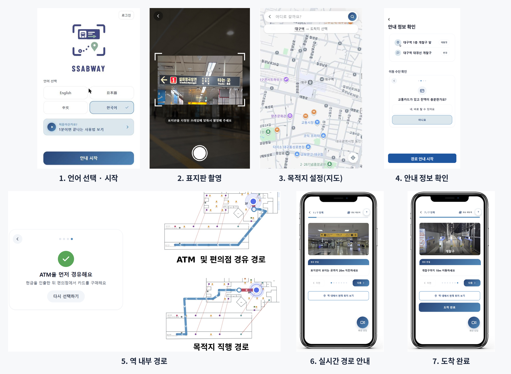
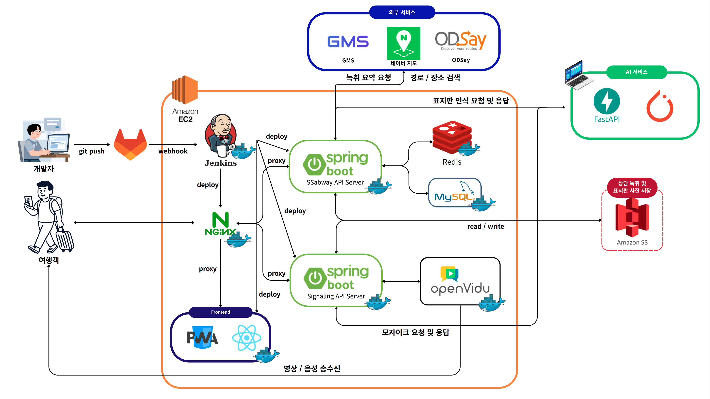

# SSabway

역 안에서 GPS가 끊겨도 길을 잃지 않도록, 안내 표지판을 촬영하면 AI가 위치를 인식해 목적지까지 안내하고, 막히면 역무원과 화상으로 연결하는 실내 길안내 서비스입니다.

<p align="center">
  
</p>
<p align="center"><sub>사용자 흐름 — 언어 선택 → 표지판 촬영(AI 인식) → 목적지 설정 → 안내 정보 확인(이동 수단) → 역 내부 경로 → 실시간 단계별 안내 → 도착 완료</sub></p>

제가 맡은 부분을 구현 과정까지 풀어 쓴 글은 [PORTFOLIO.md](PORTFOLIO.md)에 있습니다.

## 1. Project Overview

- 프로젝트명: SSabway — AI 표지판 인식 기반 지하철 실내 길안내·화상 상담 서비스
- 개발 기간: 2026.07.06 ~ 2026.08.14 (SSAFY 15기 2학기 공통 프로젝트)
- 팀 구성: 6명 (프론트엔드 2 · 백엔드 3 · AI 1)
- 담당 역할: 프론트엔드(2명 중 1명) — 관리자 앱 전담, 사용자 앱 인증·화상 상담 화면, 지도 통합
- GitHub: https://github.com/luster-woo/SSabway
- 기술 스택
  - Frontend (담당): React 19 · TypeScript · Vite · TailwindCSS v4 · Zustand · TanStack Query · React Router v7 · OpenVidu(WebRTC) · i18next · Google Maps JavaScript API · MSW
  - Backend: Spring Boot 4.1 · Java 21 · Spring Security + OAuth2 · JPA · JWT · MySQL · Redis
  - AI: Python · YOLOv8n + ResNet18
  - Infra: Docker Compose · Jenkins · GitLab CI · Nginx

서비스가 푸는 문제

| 이용자가 겪는 문제 | SSabway의 해결 |
|------|------|
| 실내에서 GPS가 안 잡힌다 | 역 안내 표지판을 촬영하면 AI(YOLO+ResNet)가 41종 중 위치를 인식 (실전 정확도 92.9%) |
| 어디로 어떻게 가야 할지 모른다 | 역 내부를 73개 노드·106개 엣지 그래프로 모델링, 다익스트라로 역 내 최단 경로와 대중교통 환승 경로를 안내 |
| 그래도 길을 잃었다 | 버튼 하나로 역무원과 실시간 화상 상담(WebRTC) 연결 |
| 한국어를 모른다 | 4개국어(한/영/일/중) 전면 지원 |

## 2. My Contribution

직접 담당한 기능과 개발 범위

- 관리자 앱 전체: 화면 4개, 공용 컴포넌트 6종, 라우트 가드, 관리자 API 9종 연동(블랙리스트, 상담 대기열, 상담 내역, 민원 기록)
- 사용자 앱 인증: 로그인, 회원가입, 비밀번호 재설정, 구글 소셜 로그인
- 화상 상담 화면: 사용자·관리자 화상 페이지 UI, 장치 제어, 권한 거부 처리
- 지도: 네이버 지도에서 Google Maps로 전환, 출발지 설정
- 4개국어 번역 키 227개

팀에서 구현한 부분 (제 작업이 아닙니다)

| 영역 | 담당 |
|---|---|
| OpenVidu 세션 연결 훅, 다국어 구조 설계, 프론트 폴더 구조, 역 내부 지도 최종본, 나머지 사용자 화면 | 프론트 팀원 |
| API·인증 서버, WebRTC 시그널링 서버 | 백엔드 팀원 |
| 표지판 인식 모델(41종, 정확도 92.9%), 역 내부 최단 경로 | AI·백엔드 팀원 |
| Jenkins·Docker·Nginx 배포 | 팀원 |

화면 비율 맞춤, MSW 도입, 다국어 기본 언어 수정은 프론트 두 명이 같은 PC에서 페어로 작업해 커밋이 팀원 계정에 있습니다.

## 3. Architecture

<p align="center">
  
</p>

- 전체 구조: GitLab에 push하면 Jenkins가 EC2의 Docker로 빌드·배포하고, Nginx가 API 서버(Spring Boot)와 시그널링 서버(OpenVidu)를 프록시합니다. 표지판 인식은 FastAPI 서버가 맡습니다
- 서버 간 통신: 브라우저와 API 서버는 REST·JWT, 화상 상담은 OpenVidu(WebRTC), 지도와 대중교통 경로는 외부 API(Google Maps · ODsay)
- 데이터 흐름(화상 상담): 상담 요청 → 역무원 수락 → 상담 정보를 스토어에 담고 상담 화면으로 → 종료 시 스토어 비움
- 데이터베이스: 서버 DB(MySQL · Redis)는 백엔드 팀원이 설계했습니다. 프론트는 상담 정보를 sessionStorage에 둡니다

담당 영역의 구조

```
frontend/src
├── user/     # 사용자 앱  (촬영 → 경로 안내 → 화상 상담)
├── admin/    # 관리자 앱  (상담 응대 · 내역/민원 · 블랙리스트)
├── shared/   # webrtc · api · i18n · station-map · ui  (두 앱 공통)
├── locales/  # ko · en · ja · zh
└── mocks/    # MSW 핸들러  (백엔드 병렬 개발)
```

## 4. Key Implementations

<table>
<tr>
<td width="50%" valign="top"><br><sub><b>화상 상담</b> — 얼굴 자동 모자이크 · 실시간 번역 자막 · 상담 정보 조회 · 블랙리스트 등록</sub></td>
<td width="50%" valign="top"><br><sub><b>상담 대기열 · 민원 기록</b> — 기간·이메일 검색 · 원본 기록 조회 · 블랙리스트 관리</sub></td>
</tr>
</table>

| 기능 | 구현 목적 | 적용 기술 | 기술적 고려사항 |
|---|---|---|---|
| 관리자 앱 | 역무원이 상담을 받고 내역·민원·블랙리스트를 관리 | React · TanStack Query · Zustand | 토큰 클레임 판별은 화면 이동용이지 권한 판단이 아님을 주석으로 명시 |
| 화상 상담 화면 | 길을 잃은 사용자를 역무원과 영상으로 연결 | OpenVidu(WebRTC) | 카메라 권한 거부는 오류가 아닌 흔한 선택으로 따로 처리 |
| Google Maps 통합 | 외국인 대상 서비스에 맞는 다국어 지도 | Google Maps JavaScript API · Places | GPS로 가까운 역을 찾는 기능은 만들었다가 표지판 인식으로 대체하며 제거 |
| MSW 목 서버 | 백엔드 API를 기다리지 않고 화면 개발 | MSW | 팀에 건의해 프론트 팀원과 함께 도입 |

## 5. Technical Challenges

| Situation | Cause | Solution | Result |
|---|---|---|---|
| 화상 상담에서 두 사람의 화면이 다르게 보임 | 기기마다 화면 비율이 0.46~0.56으로 다름 | 사용자 브라우저가 비율을 실행 중에 재서 시그널로 전송, 값이 없으면 기본 비율 | 서로 다른 기기로 연결을 반복해 같은 범위가 보이는 것을 확인 (페어 작업) |
| 새로고침하면 상담 정보가 사라짐 | 라우팅 state로 정보를 넘김 | sessionStorage 스토어로 옮기고 상담 종료 시 비움 | 새로고침·뒤로가기에서 정보 유지 |
| 카메라 권한을 거부하면 막다른 페이지에 갇힘 | 권한 거부를 돌아갈 길 없는 페이지로 보냄 | 토스트로 안내한 뒤 이전 화면으로 | 권한을 거부해도 갇히지 않음 |
| 국내 접속 시 첫 화면이 한국어 | 언어 감지기가 브라우저 언어를 읽음 | 감지 대상을 저장된 값으로 제한 | 기본 언어가 영어로 고정 (페어 작업) |
| 프론트와 백엔드의 요청·응답 형식이 어긋남 | 와이어프레임과 API 명세를 함께 검토하지 않고 시작 | 화면 기준으로 API 계약을 먼저 맞춤 | 연동 단계의 재작업이 줄어듦 (정도는 재지 않음) |

## 6. Performance & Results

- 개선 전후 비교, API 응답 시간, 데이터 처리 성능: 재지 않았습니다. 기록이 없어 적지 않습니다
- 실측값: 기기별 화면 비율 0.46~0.56
- 범위: 화면 9개 생성과 8개 수정, 관리자 API 9종 연동, 번역 키 227개
- 시연: 팀원끼리 실제 지하철역과 개발 장소에서 시연했습니다. 실제 역무원이 관리자 앱을 쓴 적은 없습니다
- 수상: 팀이 SSAFY 공통 프로젝트 우수상(반 2등)을 받았습니다. 6명이 함께 받은 상입니다

팀 지표인 표지판 인식 정확도(92.9%)는 AI 팀원의 결과입니다.

## 7. Retrospective

- 배운 점: 통제할 수 없는 변수는 상수로 박지 않고 실행 중에 재고, 전달하고, 값이 없을 때의 기본값을 둡니다. 그리고 무엇을 만들지만큼 같은 것을 이해하고 있는지를 먼저 맞춰야 합니다
- 아쉬웠던 점: 와이어프레임과 API 명세를 초반에 함께 검토하지 않아 연동 단계에서 재작업이 생겼습니다. 출발지를 GPS로 찾는 기능은 만든 뒤에 제거했습니다
- 다시 한다면: 구현 전에 기술과 외부 API가 서비스에 맞는지 먼저 검증하고, 화면 기준 API 계약을 개발 전에 문서로 맞추겠습니다

## 협업 방식

- Git Flow + 이슈 기반 브랜치, GitLab MR 코드 리뷰
- 커밋 컨벤션 문서화([CONVENTION.md](CONVENTION.md))
- MSW 목 서버로 백엔드 API 완성 전에 화면 개발을 병렬로 진행
